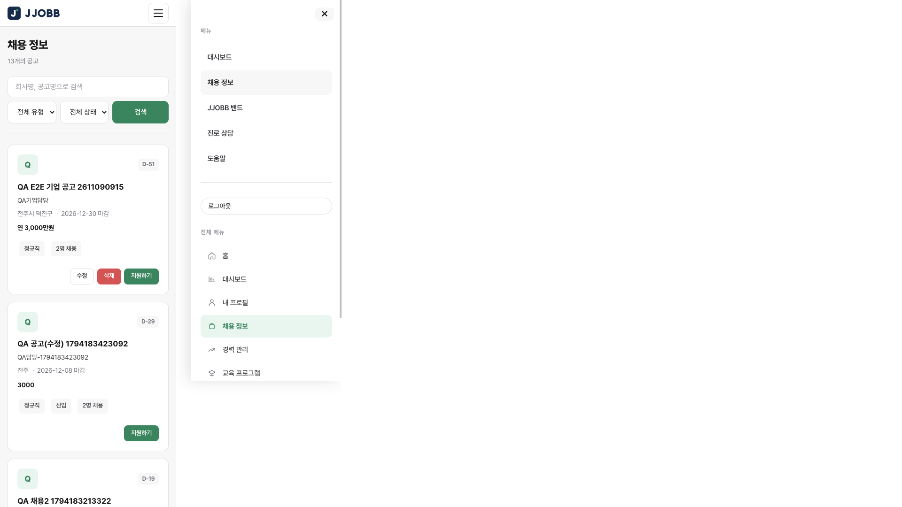
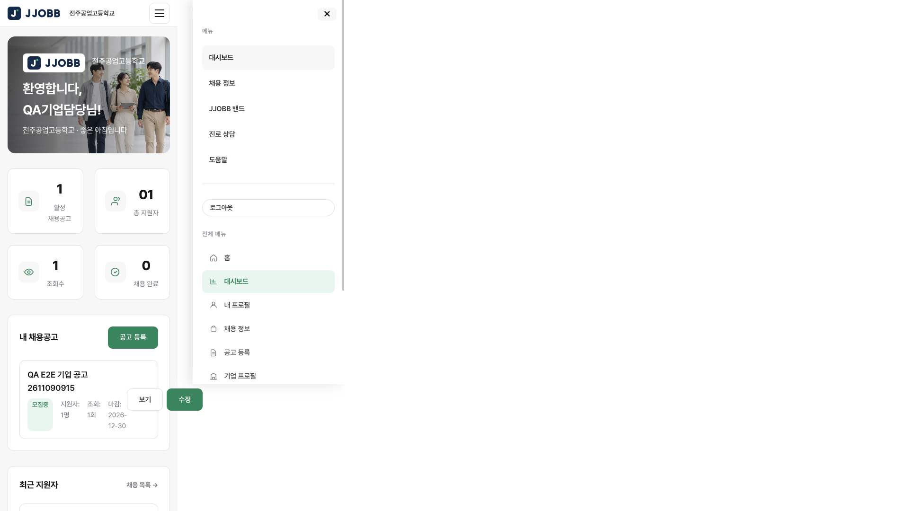
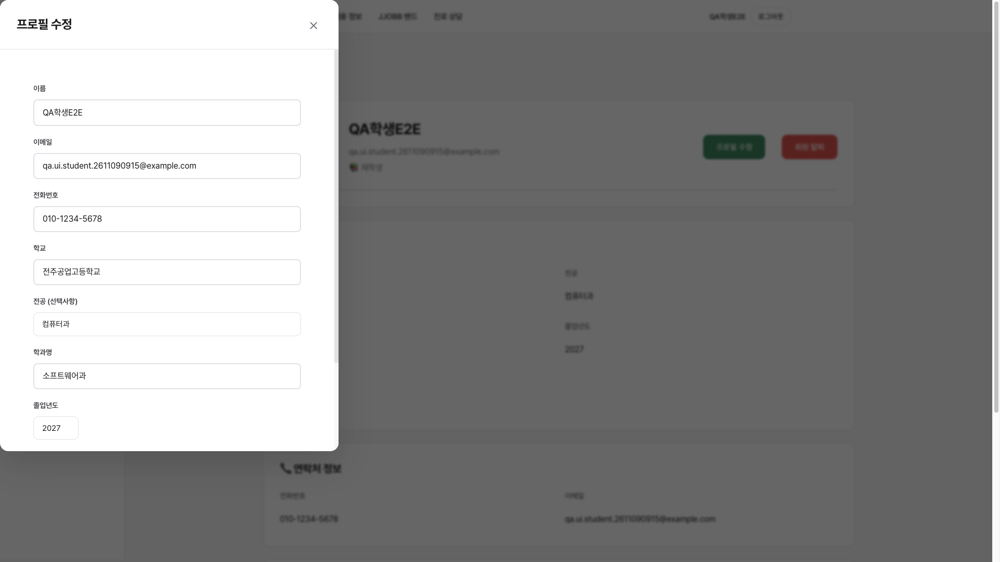
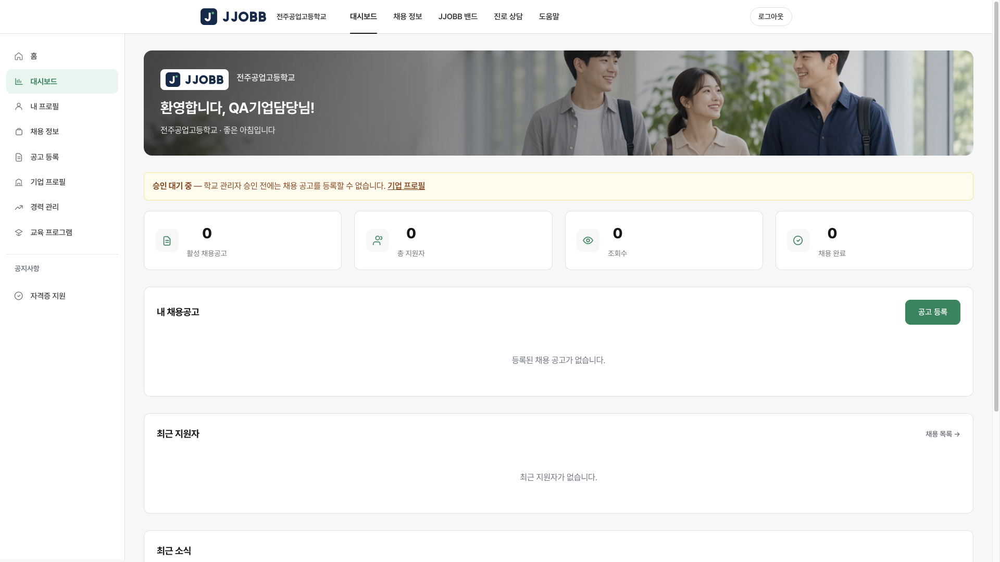
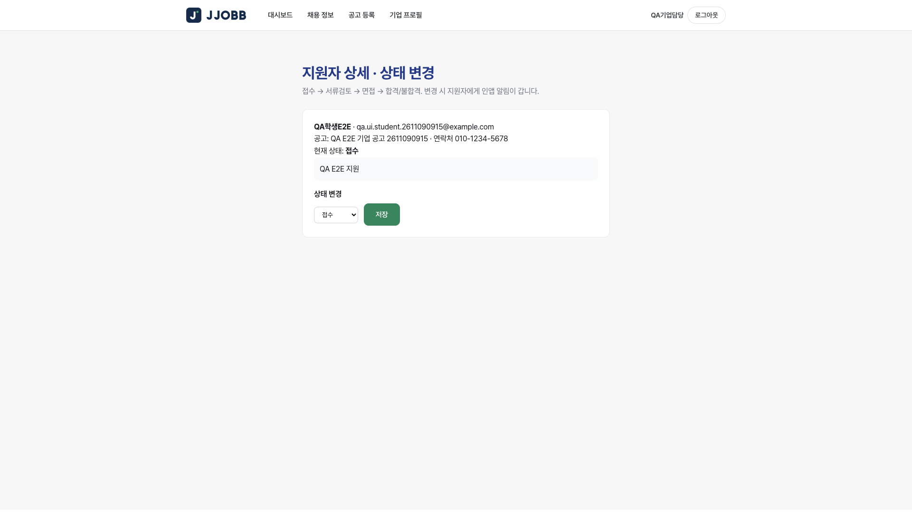

# 종합 테스트 보고서 — 계정 생성부터 전체 흐름 (2026-11-09)

역할: QA / Test  
환경: 로컬 API `http://localhost:5050`, 프론트 `http://localhost:8080`, PostgreSQL 로컬 DB  
수행: 자동 테스트 스위트 + API 시나리오 테스트 에이전트 + 브라우저 화면 테스트 에이전트  
코드 변경: 없음 (테스트만 수행)

## 1. 요약

| 구분 | 건수 | 통과 | 실패 | 제외(SKIP) |
|------|------|------|------|-----------|
| 자동 테스트 (`npm test`) | 101 | 101 | 0 | 0 |
| API 시나리오 (계정 생성 → 전 기능 → 테넌시) | 226 | 214 | 8 | 4 |
| 브라우저 화면 (가입 → 승인 → 공고 → 모바일) | 36 | 24 | 11 | 1 |
| **합계** | **363** | **339** | **19** | **5** |

핵심 업무 흐름(회원가입 → 로그인 → 기업 승인 → 공고 등록 → 이력서 → 지원 → 지원 상태 변경 → 알림, 상담·견학·커뮤니티)은 **API와 화면 모두 끝까지 동작**한다. 학교 간 데이터 격리도 공고·이력서·파일·상담일지·견학·게시글·신고 큐에서 모두 403 또는 빈 목록으로 지켜졌다.

다만 **보안 결함 2건(높음)** 과 **정책 위반·화면 결함 다수(중간)** 가 확인되어 백엔드·프론트엔드 수정이 필요하다.

## 2. 결함 목록 (우선순위순)

| # | 심각도 | REQ | 내용 | 담당 |
|---|--------|-----|------|------|
| D1 | **높음** | REQ-IAM-009, REQ-CNS-006 | 학생이 상담 예약의 담당 교사를 **타교 교사로 변경** 가능 → 타교 교사가 상태·메모 수정 가능 | Backend |
| D2 | **높음** | REQ-JOB-007, REQ-NFR-003 | **승인 대기 기업**이 같은 학교 학생 이메일·전화번호 조회 가능 | Backend |
| D3 | 중간 | REQ-CNS-006 | 담당자를 교사가 아닌 사용자(졸업생 등)로 지정 가능 → 그 사용자에게 상담 노출 | Backend |
| D4 | 중간 | REQ-CNS-006, REQ-IAM-008 | 학생이 자기 상담 예약을 직접 "승인" 처리 가능 | Backend |
| D5 | 중간 | REQ-PLT-001 | `localStorage`에 JWT 외 `graduateNetwork_user`(이메일·전화·학교·전공), `jjobb_api_base` 저장 | Frontend |
| D6 | 중간 | REQ-PLT-007 | 375px 모바일에서 index·login·dashboard·jobs 가로 폭 727px (가로 스크롤) | Frontend |
| D7 | 중간 | REQ-IAM-008 | 관리자 대시보드 사이드바에 회원 관리·권한 매트릭스 메뉴가 숨겨짐 (URL 직접 입력만 가능) | Frontend |
| D8 | 중간 | — | 프로필 수정 모달이 가운데가 아닌 왼쪽 위에 표시 (저장은 정상) | Frontend |
| D9 | 낮음 | REQ-JOB-001 | 마감일이 하루 일찍 표시 (12-31 → 12-30, UTC 변환) | Frontend |
| D10 | 낮음 | REQ-JOB-006 | 기업 대시보드 "총 지원자"가 `00`, `01`로 표시 (문자열 연결) | Frontend |
| D11 | 낮음 | — | 대시보드·채용 페이지 헤더에 사용자 이름 미표시 | Frontend |
| D12 | 낮음 | REQ-PLT-004 | 대시보드에서 `GET /api/schools/1/logo` 404 | Backend |
| D13 | 낮음 | docs/04 §1 | 중복 이메일 가입 시 409가 아닌 400 반환 (거부 자체는 정상) | API |

### D1 · D3 · D4 — 상담 예약 수정 API 검증 누락

재현:
1. 학생 A(학교 1): `POST /api/counseling {counselor_id: 교사A, session_date}` → 201
2. 학생 A: `PUT /api/counseling/:id {counselor_id: 교사B(학교 2)}` → **200** (기대 403)
3. 교사 B: `PUT /api/counseling/:id {status:"completed", notes:"…"}` → **200** (기대 403)
4. 학생 A: `PUT /api/counseling/:id {counselor_id: 졸업생A}` → **200** → 졸업생 A의 `GET /api/counseling`에 학생 A 상담 노출
5. 학생 A: `PUT /api/counseling/:id {status:"approved"}` → **200** (기대 403)

원인 추정: `backend/routes/counseling.js` `PUT /:id`(258행)가 `counselor_id`를 검증 없이 저장(285행). 신규 예약(POST, 183–195행)에서는 같은 학교·교사 여부를 검사한다. `canAccessSession`(23행)은 담당자이기만 하면 학교 확인 없이 접근을 허용한다. 상태 변경(288행)에 역할 검사가 없다.

### D2 — 승인 대기 기업의 학생 개인정보 열람

재현:
1. `POST /api/auth/register {user_type:"company", school_id:1, company_name}` → 승인 대기
2. 그 토큰으로 `GET /api/users?user_type=student` → **200**, 학생 24명 이메일·전화 포함
3. `GET /api/users/177` → **200**, 이메일·전화 포함

원인 추정: `backend/routes/users.js` `GET /`(468행)에 메뉴 권한·승인 상태 확인이 없고 학교 범위만 적용. `GET /:id`(189행)의 `canReadUser`(12–17행)도 같은 학교면 역할 구분 없이 허용.

### D5 — localStorage 정책 위반

로그인 후 `Object.keys(localStorage)` → `["jjobb_api_base","token","graduateNetwork_user"]`. 정책은 JWT만 허용. 기업 프로필 화면의 "(JWT 이외 LocalStorage 미사용)" 문구와도 맞지 않는다.

### D6 — 모바일 가로 넘침

375px에서 닫힌 `.nav-drawer`가 화면 오른쪽 밖(727px)에 위치하고 가로 overflow가 숨겨지지 않아 문서 폭이 727px이 된다. 대시보드는 공고 카드의 보기/수정 버튼(`.job-posting-actions`)도 428px까지 넘친다.




### D8 — 프로필 수정 모달 위치



## 3. 정상 동작 확인 항목

### 회원가입·로그인 (REQ-IAM-004/006, REQ-NFR-002)
- 재학생·졸업생·교사·기업 가입 성공, 학교 선택 목록은 `GET /api/schools`에서 로드 (12개 학교)
- 중복 이메일, 필수값 누락, 잘못된 이메일, 잘못된 학교, 7자 비밀번호, 졸업연도 누락 → 거부
- `admin` / `system_admin` / `school_admin` 자가 가입 → 거부. 요청 본문에 `role:system_admin` 주입해도 무시
- 화면: 빈 폼 제출 차단, 비밀번호 불일치 메시지, 가입 후 자동 로그인 → 대시보드
- 틀린 비밀번호·없는 이메일 401, 서명 변조 JWT·`alg=none` JWT 401

### 기업 승인 (REQ-JOB-007)
- 기업 가입 시 승인 대기, 대기 중 공고 등록 403 `COMPANY_NOT_APPROVED`, 화면에서도 폼 비활성 + 배너
- 교사는 기업 목록·승인 불가(403), 반려 시 사유 필수, 관리자 승인 200, 감사 로그 기록



### 채용·이력서·지원 (REQ-JOB-001/003/004/005/006, REQ-RSM-001~005)
- 승인 기업 공고 등록·수정, 타 기업 공고 수정 403
- 이력서 작성·수정·미리보기, PDF 생성(`%PDF`) 및 파일 저장, 이력서 첨부 지원, 중복 지원 거부
- 타인 이력서로 지원 403, 기업은 자기 공고 지원자만 조회
- 지원 상태 단계 전이 검증(건너뛰기·역행 400), 학생·기업 인앱 알림
- 화면: 목록·검색("용접" 3건)·필터·상세 모달·지원·지원자 상세 상태 변경 정상



### 상담 (REQ-CNS-001~006)
- 예약 시 타교 교사 지정 403, 교사 알림, 승인, 상담일지 작성, 후속 알림, 타임라인, 통계
- 상담일지 PDF / DOCX 출력, 학생은 일지 작성 불가, 다른 학생·다른 교사 열람 403

### 견학 (REQ-TRP-001~003)
- 교사만 생성, 선착순 승인, 중복 409, 정원 초과 400, 취소 후 재신청, 승인제 대기 → 승인, 명단, 알림

### 커뮤니티 (REQ-COM-001/002/003/005)
- 글·댓글·좋아요·스크랩·태그, 신고(사유 필수), 같은 학교 교사만 블라인드, 블라인드 글 숨김, 익명 마스킹

### 테넌시·권한 (REQ-IAM-008/009, REQ-PLT-003)
- 학교 B 교사·학생의 학교 A 학생·이력서·파일·상담일지·상담·공고·견학·게시글 접근 → 모두 403 또는 빈 목록
- 학생의 관리자 API 12종 호출 → 모두 403
- 비로그인 보호 API 17종 → 모두 401
- 화면: 학생이 admin-users / admin-permissions 직접 접근 시 대시보드로 이동, 비로그인 대시보드 접근 시 로그인으로 이동

### 조건부 연동 (게이트 닫힘 → SKIP)
- 워크넷 `GET /api/worknet/status` → `configured=false`, `NOT_CONFIGURED`; 동기화 503
- 알림톡·SMS 프로바이더 `NOT_CONFIGURED` (가짜 성공 없음)

## 4. 검토가 필요한 위험 요소 (실패로 집계하지 않음)

- **교사 자가 가입 즉시 권한:** 공개 가입 교사가 검증 없이 같은 학교 학생 이력서 열람·지원 상태 변경·게시글 블라인드 가능. 기업과 같은 승인 단계 도입 검토 (Architect 정책 결정 필요)
- **학교 내 사용자 목록 연락처 노출:** 학생·승인 기업도 `GET /api/users`로 같은 학교 사용자 이메일·전화 조회 가능. 네트워킹 화면이 사용하므로 응답에서 개인정보를 빼는 방향 권장
- **`include_withdrawn=true` 미가드** (`users.js` 484행): 학생도 탈퇴 회원 목록 조회 가능
- **학생 상담 교사 목록**에 타교 소속으로 보이는 교사("S2교사A") 표시 — 확인 필요
- **화면 소소한 문제:** 중복 지원 오류 후 모달 유지, 지원 후에도 "지원하기" 표시, 기업에게 지원하기 버튼 노출, 기업 사이드바에 학생 메뉴(경력 관리·내 프로필), 커뮤니티 카테고리 코드(`job_qa`) 그대로 표시, 관리자 알림 "불러오는 중" 고정, 메인 통계 0 표시
- 403 메시지가 메뉴 권한 거부에도 "소속 학교 권한이 없습니다"로 나와 원인 파악이 어려움

## 5. 테스트로 생성된 데이터

DB에서 삭제하지 않았다 (개발 DB 전용).

| 출처 | 계정 | 비밀번호 |
|------|------|----------|
| API 테스트 | `qa+stuA/gradA/tchA/comp/stuB/tchB/roleinj+1794183423092@example.com`, `qa+pendco+1794183433274@example.com`, `qa+pendco2+1794183446732@example.com` (user 177–185) | `QaPassw0rd!` |
| 화면 테스트 | `qa.ui.student.2611090915@example.com` (176), `qa.ui.company.2611090915@example.com` (186, 승인됨) | `Qatest123!` |

그 외: 공고 86·87, 지원 50–53, 이력서 36·37, 상담 12–15, 상담일지 28, 견학 28·29, 게시글 43–45 및 관련 알림·감사 로그.

## 6. 수정 후 재검증 (2026-11-09 10:10)

D1–D13을 백엔드(`counseling.js`, `users.js`, `schools.js`, `auth.js`, `jobs.js`)와 프론트엔드(`js/auth.js` 외)에서 수정한 뒤 다시 검증했다.

| 구분 | 결과 |
|------|------|
| 자동 테스트 (`npm test`, 회귀 13건 추가) | **114 / 114 통과** |
| API 블랙박스 (실행 중인 5050 서버, 신규 가입 계정 9개) | **64 / 64 통과** |
| 브라우저 (학생·교사·기업·관리자) | **D5–D11 전부 통과** |

| 결함 | 재검증 결과 |
|------|-------------|
| D1 | 학생이 담당을 타교 교사로 변경 403, 타교 교사 수정 403, 같은 학교 교사로 변경 200 |
| D2 | 승인 대기 기업 `/users`, `/users/:id` 403 `COMPANY_NOT_APPROVED`. 승인 기업의 학생 목록 36명 중 이메일·전화 노출 0건. 본인·같은 학교 교사는 이메일 조회 가능. 학생 `include_withdrawn` 403 |
| D3 | 졸업생을 담당자로 지정 404, 졸업생 목록에 노출 안 됨 |
| D4 | 학생 자가 승인 403, 본인 취소 200, 담당 교사 승인 200 |
| D5 | 로그인 후 `localStorage` = `token` + `jjobb_api_base`(개발용 설정, 허용). 남은 `graduateNetwork_user`는 새로고침 시 삭제 |
| D6 | 375px에서 index·login·dashboard·jobs 폭 375 (이전 727). 모바일 메뉴 링크가 맨 위에 있어 클릭 가능 |
| D7 | 관리자 사이드바에 회원 관리·권한 매트릭스 등 6개 표시. 학생·교사·기업은 숨김 |
| D8 | 프로필 수정 창 위아래 92px 여백, 좌우 308/323px (차이는 스크롤바 폭) |
| D9 | 마감일 2026-12-31 공고가 "2026-12-31 마감"으로 표시 |
| D10 | 기업 대시보드 총 지원자 "2" |
| D11 | 대시보드·채용 화면 헤더에 사용자 이름 표시 (김재학, 박선생, JJOBB채용담당, JJOBB관리자) |
| D12 | `/api/schools/1/logo` 204, 없는 학교 404 |
| D13 | 중복 가입·중복 지원 모두 409 `CONFLICT` |

회귀: 가입·로그인, 관리자 자가 가입 거부, 기업 승인(교사 403), 공고 등록·지원·상태 변경·알림, 이력서·상담일지 PDF, 견학 정원, 게시글 신고·블라인드, 타교 403, 비로그인 401, 학생의 관리자 화면 직접 접근 시 대시보드로 이동, 비로그인 대시보드 접근 시 로그인으로 이동, 워크넷 `NOT_CONFIGURED` — 모두 정상.

참고: 스크립트 태그에 버전 쿼리가 없어 브라우저가 이전 `auth.js`를 캐시하면 첫 방문에서 옛 동작이 남을 수 있다(재검증 첫 시도에서 관찰, 새로고침 후 정상). 배포 시 캐시 무효화 권장.

재검증용 계정: `qa.verify.*.1794186606882@example.com` (비밀번호 `QaVerify123!`), 중단된 1차 재검증 `qa.verify+<역할>+1794185040236@example.com` (user 270–279).

추가 확인: 프로필 희망 직무 저장 의심 건은 JS로 입력·저장해 `/auth/me`에 반영됨을 확인 — 결함 아님(브라우저 입력 도구 문제). 신규 관찰(낮음): 대시보드 알림 시간이 UTC 원문으로 표시됨 → `js/api.js` `formatLocalDateTime()`(Asia/Seoul) 추가, `js/dashboard.js` 알림 목록 적용으로 수정 (UTC 00:11 → 09:11 표시 확인).

## 7. 핸드오프

```
Handoff: qa → backend
REQ: REQ-IAM-009, REQ-CNS-006, REQ-JOB-007, REQ-NFR-003
Need: D1·D3·D4 counseling.js PUT /:id — counselor_id 같은 학교 teacher 검증, canAccessSession 학교 확인, status 변경은 담당 교사/staff만
      D2 users.js GET / , GET /:id — 승인 대기 기업 차단, 이메일·전화 최소화
      D12 /api/schools/:id/logo 404
Done: API 226건 실행, 재현 단계 본 보고서 §2
```

```
Handoff: qa → frontend
REQ: REQ-PLT-001, REQ-PLT-007, REQ-IAM-008
Need: D5 graduateNetwork_user·jjobb_api_base localStorage 제거(사용자 정보는 /api/auth/me)
      D6 .nav-drawer 닫힘 상태 overflow, .job-posting-actions 줄바꿈
      D7 관리자 사이드바 admin 메뉴 표시, D8 프로필 모달 중앙, D9 마감일 KST, D10 지원자 수 숫자 합산, D11 헤더 이름
Done: 브라우저 36건 실행, 스크린샷 docs/qa/img/comprehensive-2026-11-09/
```

```
Handoff: qa → api
REQ: docs/04 §1
Need: D13 중복 이메일 409 CONFLICT, 중복 지원 응답에 code 필드
```
